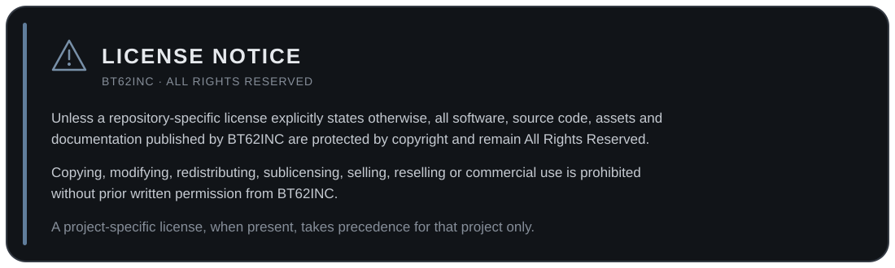

  <picture>
    <source media="(prefers-color-scheme: dark)" srcset="https://raw.githubusercontent.com/BT62INC/logo/main/LogoSimple-Claire.png">
    <source media="(prefers-color-scheme: light)" srcset="https://raw.githubusercontent.com/BT62INC/logo/main/LogoSimple-Sombre.png">
    
  </picture>

  <h1>BT62INC</h1>

  
<strong>Building useful things, one experiment at a time.</strong>

  
Software · Infrastructure · Security · Automation

  

    
    
    
    
  

   

  
Curious by nature. Focused on clean, secure and practical systems.

  Private builds. Public curiosity.

---

  

